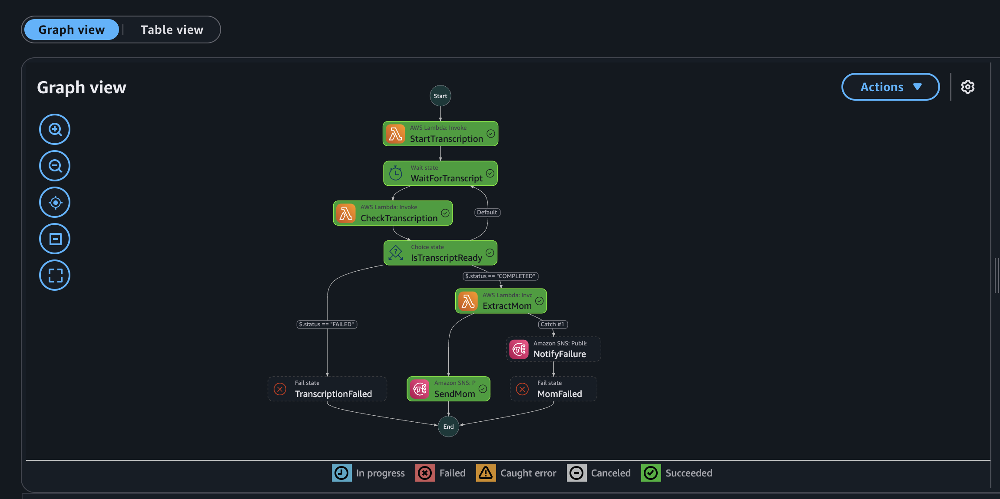
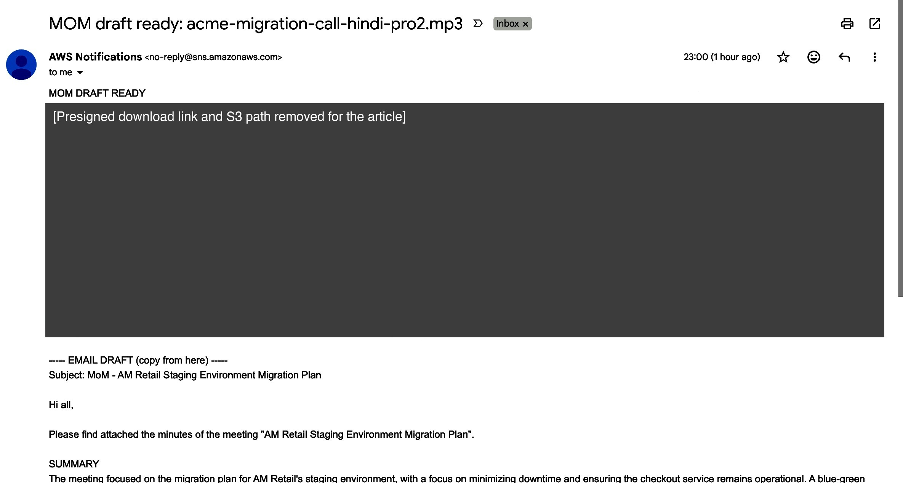
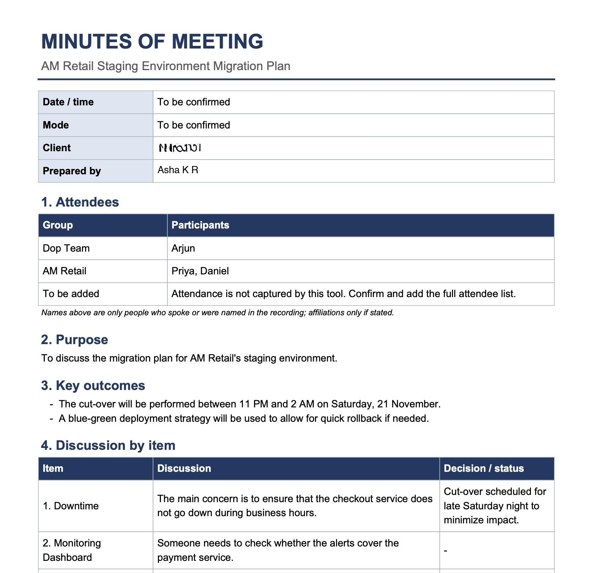

# From a recorded call to a minutes-of-meeting PDF and email draft: a serverless pipeline on AWS (Hindi and English)

*Amazon S3, EventBridge, AWS Step Functions, Amazon Transcribe, Amazon Bedrock, Amazon SNS, AWS Lambda, AWS SAM*

I am a DevOps engineer. After almost every customer meeting I write the minutes of meeting (MOM): who decided what, who owns which action, and by when. I send them as an email draft with a PDF in our company MOM layout (document-control header, attendees, purpose, key outcomes, discussion by item, action items with owner and due date). Many of my client calls are in Hindi, but the MOM has to be in English.

This article shows how I automated the first draft of that work, step by step, with the full code, and, just as important, what broke while I tested it. Every number and every "it works" statement below comes from my own test log (entries Run 0 to Run 17, all on 10 November 2026) or from the AWS documentation I link. Nothing here is a benchmark: I tested with two synthetic phone calls made with Amazon Polly (one English, one Hindi/English), not with real customer audio. A real-recording test is still open (see [Tradeoffs and what I have not tested](#tradeoffs-and-what-i-have-not-tested)).

> **Please read before using the output:** the model is an assistant, not an authority. Every MOM this pipeline produces must be read by a person before it is sent. In my tests it dropped action items and copied a speech-to-text error into a decision. Details are in the "what went wrong" section.

## What the pipeline does

1. I upload a recording to `uploads/` in one S3 bucket.
2. An EventBridge rule (S3 "Object Created", `uploads/` prefix only) starts a Step Functions state machine.
3. A Lambda starts an Amazon Transcribe job with speaker labels and Hindi + English language detection.
4. The state machine waits and polls until the job is done.
5. A Lambda reads the transcript, asks Amazon Bedrock (Amazon Nova, Converse API, temperature 0) for a JSON MOM in English, validates it, retries once with the error message if needed, builds the PDF, and saves it in S3.
6. SNS emails me an email draft (text I can paste into my mail client) plus a download link for the PDF. I attach the PDF myself.

```
 recording.mp3
      |
      v
 S3 bucket --(Object Created, prefix uploads/)--> EventBridge rule
   uploads/                                              |
   transcripts/                                          v
   mom/                                    Step Functions state machine
      ^                                                  |
      |   StartTranscription (Lambda)                    |
      |        |                                         |
      |        v                                         |
      |   Wait 20 s --> CheckTranscription (Lambda)      |
      |        ^                 |                       |
      |        |                 v                       |
      |        +-- other <-- Choice --FAILED--> Fail     |
      |                          |                       |
      |                      COMPLETED                   |
      |                          v                       |
      |   ExtractMom (Lambda): transcript -> Bedrock     |
      |     -> validated JSON -> PDF + email draft       |
      +-- writes mom/*.pdf, .json, -draft.txt            |
          Retry; Catch -> failure email -> Fail          |
                                 |                       |
                                 v                       |
                      SendMom (SNS publish) --> my inbox
```

{width=95%}

## Why I made each choice

**One S3 bucket, three prefixes, an EventBridge rule on `uploads/` only.** Transcribe writes its transcript back into the same bucket, and my Lambda writes the PDF there too. If the trigger watched the whole bucket, every output would start another run. Filtering on the `uploads/` prefix means the pipeline cannot loop. In my first run the transcript landed in `transcripts/` and no second execution started (TESTLOG Run 7).

**Step Functions instead of one big Lambda.** Transcription takes tens of seconds to minutes, and Lambda should not sit waiting for it. The state machine does the waiting (a `Wait` state and a `Choice` that loops until the job is `COMPLETED` or `FAILED`), and each Lambda stays short. It also gives me a visual execution graph and per-state retry and error handling. The whole workflow has a 30-minute timeout so a stuck job cannot loop forever. I added that after reviewing the starter code, not because it happened.

**Amazon Transcribe with speaker labels and multi-language identification.** A MOM needs owners. If the transcript is one block of text, "I will send the runbook" has no owner. With `ShowSpeakerLabels` Transcribe labels turns as `spk_0`, `spk_1`... ([documentation](https://docs.aws.amazon.com/transcribe/latest/dg/diarization.html)). For Hindi and English in one call I use multi-language identification, which transcribes each language as spoken ([documentation](https://docs.aws.amazon.com/transcribe/latest/dg/lang-id-batch.html)). Transcribe does not translate, so the transcript stays Hindi and English mixed; translation happens in the model step. I confirmed in my tests that speaker labels work together with multi-language identification (Hindi test: `language_codes: hi-IN`, `speakers: 2`).

**Amazon Bedrock, Converse API, temperature 0, JSON validated in code.** Converse gives one request shape across models, so changing the model is a one-parameter change (`BedrockModelId`). That mattered: I started with Amazon Nova Lite and ended with Amazon Nova Pro after real runs showed Nova Lite dropping action items. Temperature 0 keeps the output as repeatable as possible. I do not trust the model's JSON: the code checks every field, and if it fails, asks once more with the error message. The second failure fails the workflow and sends a failure email.

**Never guess an owner or a date.** The prompt says `null` for anything not stated, and the email shows `UNASSIGNED` and `no date`. One action item in my fake call has no owner on purpose, to check this.

**Dates are copied, then checked against the transcript.** Speech-to-text can slip ("November twenty first" became "November 201" in my first run). The prompt tells the model to copy dates as written, and the code checks that each date really appears in the transcript. More on this in the failures section.

**SNS email with a link, instead of a real attachment.** The SNS "Email" transport sends regular text-based messages ([SNS FAQ](https://aws.amazon.com/sns/faqs/)); I did not find a way to attach a file to one, so a PDF cannot ride along. I considered Amazon SES, but a new SES account is in the sandbox, where you can only send to verified addresses, and every sender identity must be verified ([documentation](https://docs.aws.amazon.com/ses/latest/dg/request-production-access.html)). So I chose the simplest option that fits my workflow: the PDF goes to S3, SNS emails a download link, and I attach the PDF myself to the email draft. The draft text is in the email body (to copy and paste) and also saved as a file in S3.

**Least-privilege IAM.** Each Lambda only gets what it needs: for example `start_job` can start Transcribe jobs named `mom-*`, read `uploads/*` and write `transcripts/*`; `extract_mom` can read `transcripts/*`, read/write `mom/*` and invoke one specific Bedrock model. The exact policies are in the template below. Transcribe worked with only those S3 permissions in my tests (it did not need `s3:ListBucket`).

**A PDF library that runs on Lambda.** I use `fpdf2` (pure Python plus Pillow). I was building on a Mac for an x86_64 Lambda, so I checked: `sam build` downloaded Linux wheels (`_imaging.cpython-312-x86_64-linux-gnu.so`), so no Docker was needed.

## Prerequisites

- An AWS account, AWS CLI v2 logged in with a profile you can use (I used `--profile <your-profile>` everywhere).
- AWS SAM CLI (I used 1.171.0), `cfn-lint` (1.58.0), Python 3.12 (the Lambda runtime), AWS CLI 2.36.47.
- Access to the Bedrock model you choose in us-east-1. I checked with read-only commands before deploying:

```bash
aws bedrock list-foundation-models --profile <your-profile> --region us-east-1 --by-provider amazon \
  --query "modelSummaries[?modelId=='amazon.nova-lite-v1:0'].[modelId,modelLifecycle.status,inferenceTypesSupported]"
aws bedrock get-foundation-model-availability --profile <your-profile> --region us-east-1 --model-id amazon.nova-lite-v1:0
```

  In my account both Nova Lite and Nova Pro showed `authorizationStatus: AUTHORIZED` and supported on-demand use, so I did not have to change anything in the console. If yours says otherwise, enable model access in the Bedrock console instead of working around it.
- **Set an AWS Budgets alert before you deploy.** I used an existing monthly cost budget.
- An email address for the SNS subscription.

Set up the tools in a virtual environment:

```bash
/opt/homebrew/bin/python3.12 -m venv .venv      # Python 3.12 to match the Lambda runtime
.venv/bin/pip install aws-sam-cli cfn-lint boto3 fpdf2
```

## The code

Project layout:

```
meeting-to-mom/
  template.yaml
  statemachine/mom.asl.json
  src/start_job/app.py
  src/check_job/app.py
  src/extract_mom/app.py
  src/extract_mom/mom_pdf.py
  src/extract_mom/requirements.txt
  scripts/generate_meeting.py          # English test call (Polly)
  scripts/generate_meeting_hindi.py    # Hindi/English test call (Polly)
  tests/test_validate.py
  tests/test_start_job.py
```

### `template.yaml`

```yaml
AWSTemplateFormatVersion: "2010-09-09"
Transform: AWS::Serverless-2016-10-31
Description: Meeting recording to MOM email

Parameters:
  NotificationEmail:
    Type: String
    Description: Address that receives the MOM
    AllowedPattern: '[^@\s]+@[^@\s]+\.[^@\s]+'
    ConstraintDescription: Must be an email address
  BedrockModelId:
    Type: String
    Default: amazon.nova-lite-v1:0
  MaxSpeakers:
    Type: Number
    Default: 2
    MinValue: 2
    MaxValue: 30
    Description: Number of speakers Transcribe should separate (2 for the test call)
  TranscribeLanguages:
    Type: CommaDelimitedList
    Default: "hi-IN,en-IN"
    Description: One code (e.g. en-US) or several for mixed-language calls (e.g. hi-IN,en-IN)
  PreparedBy:
    Type: String
    Default: ""
    Description: Name printed in the "Prepared by" field and the email signature (blank = placeholder)
  LogRetentionDays:
    Type: Number
    Default: 14

Globals:
  Function:
    Runtime: python3.12
    Timeout: 30
    MemorySize: 256
    Environment:
      Variables:
        BUCKET: !Ref AudioBucket

Resources:
  AudioBucket:
    Type: AWS::S3::Bucket
    Properties:
      PublicAccessBlockConfiguration:
        BlockPublicAcls: true
        BlockPublicPolicy: true
        IgnorePublicAcls: true
        RestrictPublicBuckets: true
      NotificationConfiguration:
        EventBridgeConfiguration:
          EventBridgeEnabled: true

  StartJobLogGroup:
    Type: AWS::Logs::LogGroup
    Properties:
      RetentionInDays: !Ref LogRetentionDays

  CheckJobLogGroup:
    Type: AWS::Logs::LogGroup
    Properties:
      RetentionInDays: !Ref LogRetentionDays

  ExtractMomLogGroup:
    Type: AWS::Logs::LogGroup
    Properties:
      RetentionInDays: !Ref LogRetentionDays

  MomTopic:
    Type: AWS::SNS::Topic
    Properties:
      Subscription:
        - Protocol: email
          Endpoint: !Ref NotificationEmail

  StartJobFunction:
    Type: AWS::Serverless::Function
    Properties:
      CodeUri: src/start_job/
      Handler: app.handler
      LoggingConfig:
        LogGroup: !Ref StartJobLogGroup
      Environment:
        Variables:
          MAX_SPEAKERS: !Ref MaxSpeakers
          TRANSCRIBE_LANGUAGES: !Join [",", !Ref TranscribeLanguages]
      Policies:
        - Statement:
            - Effect: Allow
              Action: transcribe:StartTranscriptionJob
              Resource: !Sub "arn:${AWS::Partition}:transcribe:${AWS::Region}:${AWS::AccountId}:transcription-job/mom-*"
            - Effect: Allow
              Action: s3:GetObject
              Resource: !Sub "${AudioBucket.Arn}/uploads/*"
            - Effect: Allow
              Action: s3:PutObject
              Resource: !Sub "${AudioBucket.Arn}/transcripts/*"

  CheckJobFunction:
    Type: AWS::Serverless::Function
    Properties:
      CodeUri: src/check_job/
      Handler: app.handler
      LoggingConfig:
        LogGroup: !Ref CheckJobLogGroup
      Policies:
        - Statement:
            - Effect: Allow
              Action: transcribe:GetTranscriptionJob
              Resource: !Sub "arn:${AWS::Partition}:transcribe:${AWS::Region}:${AWS::AccountId}:transcription-job/mom-*"

  ExtractMomFunction:
    Type: AWS::Serverless::Function
    Properties:
      CodeUri: src/extract_mom/
      Handler: app.handler
      LoggingConfig:
        LogGroup: !Ref ExtractMomLogGroup
      Timeout: 120
      MemorySize: 512
      Environment:
        Variables:
          MODEL_ID: !Ref BedrockModelId
          PREPARED_BY: !Ref PreparedBy
      Policies:
        - Statement:
            - Effect: Allow
              Action: s3:GetObject
              Resource: !Sub "${AudioBucket.Arn}/transcripts/*"
            - Effect: Allow
              Action:
                - s3:PutObject
                - s3:GetObject
              Resource: !Sub "${AudioBucket.Arn}/mom/*"
            - Effect: Allow
              Action: bedrock:InvokeModel
              Resource: !Sub "arn:aws:bedrock:${AWS::Region}::foundation-model/${BedrockModelId}"

  MomStateMachine:
    Type: AWS::Serverless::StateMachine
    Properties:
      DefinitionUri: statemachine/mom.asl.json
      DefinitionSubstitutions:
        StartJobFunctionArn: !GetAtt StartJobFunction.Arn
        CheckJobFunctionArn: !GetAtt CheckJobFunction.Arn
        ExtractMomFunctionArn: !GetAtt ExtractMomFunction.Arn
        TopicArn: !Ref MomTopic
      Policies:
        - LambdaInvokePolicy:
            FunctionName: !Ref StartJobFunction
        - LambdaInvokePolicy:
            FunctionName: !Ref CheckJobFunction
        - LambdaInvokePolicy:
            FunctionName: !Ref ExtractMomFunction
        - SNSPublishMessagePolicy:
            TopicName: !GetAtt MomTopic.TopicName
      Events:
        AudioUploaded:
          Type: EventBridgeRule
          Properties:
            Pattern:
              source:
                - aws.s3
              detail-type:
                - Object Created
              detail:
                bucket:
                  name:
                    - !Ref AudioBucket
                object:
                  key:
                    - prefix: uploads/

Outputs:
  BucketName:
    Value: !Ref AudioBucket
  StateMachineArn:
    Value: !Ref MomStateMachine
```

Notes: the bucket has `EventBridgeEnabled: true` so S3 sends events to EventBridge; the rule is declared as an `EventBridgeRule` event on the state machine (SAM creates the rule and its role); the Lambda log groups are declared in the template with a retention period, so `sam delete` removes them (otherwise Lambda creates them on its own and they stay behind).

### `statemachine/mom.asl.json`

```json
{
  "Comment": "Meeting recording to MOM email",
  "TimeoutSeconds": 1800,
  "StartAt": "StartTranscription",
  "States": {
    "StartTranscription": {
      "Type": "Task",
      "Resource": "arn:aws:states:::lambda:invoke",
      "Parameters": {
        "FunctionName": "${StartJobFunctionArn}",
        "Payload.$": "$"
      },
      "OutputPath": "$.Payload",
      "Retry": [
        {
          "ErrorEquals": ["Lambda.ServiceException", "Lambda.AWSLambdaException", "Lambda.SdkClientException", "Lambda.TooManyRequestsException"],
          "IntervalSeconds": 5,
          "MaxAttempts": 3,
          "BackoffRate": 2
        }
      ],
      "Next": "WaitForTranscript"
    },
    "WaitForTranscript": {
      "Type": "Wait",
      "Seconds": 20,
      "Next": "CheckTranscription"
    },
    "CheckTranscription": {
      "Type": "Task",
      "Resource": "arn:aws:states:::lambda:invoke",
      "Parameters": {
        "FunctionName": "${CheckJobFunctionArn}",
        "Payload.$": "$"
      },
      "OutputPath": "$.Payload",
      "Retry": [
        {
          "ErrorEquals": ["Lambda.ServiceException", "Lambda.AWSLambdaException", "Lambda.SdkClientException", "Lambda.TooManyRequestsException"],
          "IntervalSeconds": 5,
          "MaxAttempts": 3,
          "BackoffRate": 2
        }
      ],
      "Next": "IsTranscriptReady"
    },
    "IsTranscriptReady": {
      "Type": "Choice",
      "Choices": [
        { "Variable": "$.status", "StringEquals": "COMPLETED", "Next": "ExtractMom" },
        { "Variable": "$.status", "StringEquals": "FAILED", "Next": "TranscriptionFailed" }
      ],
      "Default": "WaitForTranscript"
    },
    "TranscriptionFailed": {
      "Type": "Fail",
      "Error": "TranscriptionFailed",
      "CausePath": "$.failureReason"
    },
    "ExtractMom": {
      "Type": "Task",
      "Resource": "arn:aws:states:::lambda:invoke",
      "Parameters": {
        "FunctionName": "${ExtractMomFunctionArn}",
        "Payload.$": "$"
      },
      "OutputPath": "$.Payload",
      "Retry": [
        {
          "ErrorEquals": ["Lambda.ServiceException", "Lambda.AWSLambdaException", "Lambda.SdkClientException", "Lambda.TooManyRequestsException"],
          "IntervalSeconds": 5,
          "MaxAttempts": 2,
          "BackoffRate": 2
        }
      ],
      "Catch": [
        { "ErrorEquals": ["States.ALL"], "ResultPath": "$.error", "Next": "NotifyFailure" }
      ],
      "Next": "SendMom"
    },
    "SendMom": {
      "Type": "Task",
      "Resource": "arn:aws:states:::sns:publish",
      "Parameters": {
        "TopicArn": "${TopicArn}",
        "Subject.$": "$.emailSubject",
        "Message.$": "$.emailBody"
      },
      "End": true
    },
    "NotifyFailure": {
      "Type": "Task",
      "Resource": "arn:aws:states:::sns:publish",
      "Parameters": {
        "TopicArn": "${TopicArn}",
        "Subject": "MOM generation failed",
        "Message.$": "States.Format('MOM generation failed for {}. Open the Step Functions execution for details.', $.audioKey)"
      },
      "Next": "MomFailed"
    },
    "MomFailed": {
      "Type": "Fail",
      "Error": "MomExtractionFailed",
      "Cause": "Bedrock extraction failed or returned invalid JSON"
    }
  }
}
```

### `src/start_job/app.py`

```python
import os
import re
import boto3

transcribe = boto3.client("transcribe")
BUCKET = os.environ["BUCKET"]
MAX_SPEAKERS = int(os.environ.get("MAX_SPEAKERS", "2"))
LANGUAGES = [c.strip() for c in os.environ.get("TRANSCRIBE_LANGUAGES", "en-US").split(",") if c.strip()]


def handler(event, context):
    key = event["detail"]["object"]["key"]  # e.g. uploads/acme-migration-call.mp3
    base = re.sub(r"[^0-9A-Za-z._-]", "-", key.split("/")[-1])
    job_name = f"mom-{base}-{context.aws_request_id[:8]}"  # unique per upload
    transcript_key = f"transcripts/{job_name}.json"

    # one language -> fixed code; several -> multi-language identification (e.g. Hindi + English in one call)
    if len(LANGUAGES) == 1:
        language = {"LanguageCode": LANGUAGES[0]}
    else:
        language = {"IdentifyMultipleLanguages": True, "LanguageOptions": LANGUAGES}

    transcribe.start_transcription_job(
        TranscriptionJobName=job_name,
        **language,
        Media={"MediaFileUri": f"s3://{BUCKET}/{key}"},
        OutputBucketName=BUCKET,
        OutputKey=transcript_key,
        # speaker labels (spk_0, spk_1...) so "I will do X" can be tied to a speaker
        Settings={"ShowSpeakerLabels": True, "MaxSpeakerLabels": MAX_SPEAKERS},
    )
    return {"jobName": job_name, "transcriptKey": transcript_key, "audioKey": key}
```

### `src/check_job/app.py`

```python
import boto3

transcribe = boto3.client("transcribe")


def handler(event, context):
    job = transcribe.get_transcription_job(
        TranscriptionJobName=event["jobName"]
    )["TranscriptionJob"]
    return {
        **event,
        "status": job["TranscriptionJobStatus"],
        "failureReason": job.get("FailureReason", "no reason reported"),
    }
```

### `src/extract_mom/app.py`

```python
import json
import os
import re
import boto3
from botocore.config import Config

from mom_pdf import build_pdf

s3 = boto3.client("s3", config=Config(signature_version="s3v4"))
# let boto3 retry throttling a few times before the state machine sees an error
bedrock = boto3.client(
    "bedrock-runtime",
    config=Config(retries={"max_attempts": 5, "mode": "standard"}, read_timeout=60),
)
BUCKET = os.environ["BUCKET"]
MODEL_ID = os.environ["MODEL_ID"]
PREPARED_BY = os.environ.get("PREPARED_BY", "")
LINK_SECONDS = 6 * 3600  # a URL signed with role credentials may expire earlier, see README

SYSTEM_PROMPT = """You write minutes of meeting (MOM) from a transcript.
The transcript may be in English, Hindi (Devanagari script) or a mix of both.
Write EVERY field of your answer in English, whatever language the transcript uses. Translate meaning faithfully; never add facts that were not said.
Write people's names in Latin letters (for example Daniel, Priya).
The transcript has one line per turn, prefixed with an anonymous speaker label such as spk_0 or spk_1.
Return ONLY a JSON object, with no extra text, in exactly this shape:
{
  "title": "short meeting title or null",
  "meeting_date": "date and time exactly as stated in the transcript, or null",
  "mode": "how the meeting was held (for example Microsoft Teams, phone call) only if stated, else null",
  "client": "client or company name only if stated, else null",
  "purpose": "1-2 sentences on why the meeting was held",
  "summary": "2-3 sentences",
  "attendees": [{"name": "person who speaks or is named", "group": "company or team only if stated, else null"}],
  "decisions": ["key outcome or decision, one per string"],
  "discussion_items": [
    {"item": "short topic name", "discussion": "what was discussed, 1-3 sentences", "status": "decision or status for this topic, or null"}
  ],
  "action_items": [
    {"task": "what must be done", "owner": "name or null", "due_date": "date in English as spoken or null",
     "due_date_quote": "REQUIRED whenever due_date is set and the transcript is Hindi or mixed: the exact original words of the date copied from the transcript; otherwise null"}
  ]
}
Rules:
- Use null for any field the transcript does not state. Never guess a name, company, date or owner.
- For an English transcript, copy dates and numbers EXACTLY as written in the transcript, even if they look wrong or garbled (speech-to-text can make mistakes). Never correct, calculate, convert or complete a date.
- Go through the transcript turn by turn. Include EVERY commitment ("I will ...", "X will ...", "can you ...?") and every open task as its own action item, even small ones.
- An item that was discussed but not assigned still goes in action_items with owner null.
- Open tasks with no named person MUST still be listed, for example "somebody should check whether the alerts cover the payment service" becomes {"task": "check whether the alerts cover the payment service", "owner": null, "due_date": null}. Never drop them.
- Put a task's date ONLY in due_date. Keep dates out of the task text, and never leave due_date null when the transcript gives a date for that task.
- The owner is the person who accepts or is given the task. When a speaker says "I will ...", the owner is that speaker.
- Use a real name for a speaker ONLY if that speaker states their own name in the transcript. Otherwise use the label (for example "spk_0"). Never guess a name.
- List in attendees only people who speak or are named in the transcript.
- Ignore small talk."""


NULL_WORDS = {"", "null", "none", "n/a", "na", "unassigned", "unknown", "not specified", "not stated"}


def build_transcript(data):
    """Turn Transcribe JSON into 'spk_0: text' lines. Falls back to plain text without speaker labels."""
    results = data["results"]
    labels = results.get("speaker_labels")
    if not labels:
        return results["transcripts"][0]["transcript"]
    speaker_at = {}
    for seg in labels["segments"]:
        for it in seg["items"]:
            speaker_at[it["start_time"]] = it["speaker_label"]
    turns = []  # [speaker, [words]]
    for it in results["items"]:
        word = it["alternatives"][0]["content"]
        if it["type"] == "pronunciation":
            spk = speaker_at.get(it.get("start_time"), turns[-1][0] if turns else "spk_0")
            if not turns or turns[-1][0] != spk:
                turns.append([spk, []])
            turns[-1][1].append(word)
        elif turns and turns[-1][1]:  # punctuation sticks to the previous word
            turns[-1][1][-1] += word
    return "\n".join(f"{spk}: {' '.join(words)}" for spk, words in turns)


def load_transcript(key):
    body = s3.get_object(Bucket=BUCKET, Key=key)["Body"].read()
    return build_transcript(json.loads(body))


def ask_model(transcript, feedback=None):
    user_text = f"Transcript:\n{transcript}"
    if feedback:
        user_text += f"\n\nYour previous answer was rejected: {feedback}. Return valid JSON only."
    resp = bedrock.converse(
        modelId=MODEL_ID,
        system=[{"text": SYSTEM_PROMPT}],
        messages=[{"role": "user", "content": [{"text": user_text}]}],
        inferenceConfig={"maxTokens": 4000, "temperature": 0},
    )
    return resp["output"]["message"]["content"][0]["text"]


def _clean_nullable(value, field):
    if value is None:
        return None
    if not isinstance(value, str):
        raise ValueError(f"{field} must be a string or null")
    value = value.strip()
    return None if value.lower() in NULL_WORDS else value


def parse_and_validate(raw):
    text = raw.strip()
    if text.startswith("```"):  # some models wrap JSON in code fences
        text = text.strip("`").removeprefix("json").strip()
    if not text.startswith("{") and "{" in text and "}" in text:  # text around the JSON
        text = text[text.index("{"): text.rindex("}") + 1]
    mom = json.loads(text)
    if not isinstance(mom, dict):
        raise ValueError("the answer must be a JSON object")
    if not isinstance(mom.get("summary"), str):
        raise ValueError("summary must be a string")
    decisions = mom.get("decisions")
    if not isinstance(decisions, list) or not all(isinstance(d, str) for d in decisions):
        raise ValueError("decisions must be a list of strings")
    items = mom.get("action_items")
    if not isinstance(items, list):
        raise ValueError("action_items must be a list")
    for item in items:
        if not isinstance(item, dict):
            raise ValueError("each action item must be an object")
        if not isinstance(item.get("task"), str):
            raise ValueError("each action item needs a task string")
        for field in ("owner", "due_date"):
            if field not in item:
                raise ValueError(f"{field} is missing; use null when unknown")
            item[field] = _clean_nullable(item[field], field)
        item["due_date_quote"] = _clean_nullable(item.get("due_date_quote"), "due_date_quote")
    _validate_report_fields(mom)
    return mom


def _validate_report_fields(mom):
    """Fields used by the PDF. Missing ones get safe defaults; wrong types are errors (and trigger the retry)."""
    for field in ("title", "meeting_date", "mode", "client", "purpose"):
        mom[field] = _clean_nullable(mom.get(field), field)
    attendees = mom.get("attendees", [])
    if not isinstance(attendees, list):
        raise ValueError("attendees must be a list")
    for a in attendees:
        if not isinstance(a, dict) or not isinstance(a.get("name"), str) or not a["name"].strip():
            raise ValueError("each attendee must be an object with a name string")
        a["group"] = _clean_nullable(a.get("group"), "group")
    mom["attendees"] = attendees
    topics = mom.get("discussion_items", [])
    if not isinstance(topics, list):
        raise ValueError("discussion_items must be a list")
    for t in topics:
        if not isinstance(t, dict) or not isinstance(t.get("item"), str) or not isinstance(t.get("discussion"), str):
            raise ValueError("each discussion item needs item and discussion strings")
        t["status"] = _clean_nullable(t.get("status"), "status")
    mom["discussion_items"] = topics


_WEEKDAY_DATE = re.compile(
    r"\b(?:monday|tuesday|wednesday|thursday|friday|saturday|sunday),?\s+"
    r"(?:january|february|march|april|may|june|july|august|september|october|november|december)\s+\d+\w*",
    re.IGNORECASE,
)


def _norm(text):
    text = re.sub(r"\s+", " ", text.lower())
    text = re.sub(r"(?<=\d)(?:st|nd|rd|th)\b", "", text)  # 18th == 18
    return text.strip(" .,;")


def _in_transcript(date, haystack):
    # not followed by another digit/letter: "november 20" must not match inside "november 201"
    return re.search(re.escape(_norm(date)) + r"(?![0-9a-z])", haystack) is not None


_DATE_WORDS = re.compile(
    r"\b(?:monday|tuesday|wednesday|thursday|friday|saturday|sunday)\b|"
    r"\b(?:january|february|march|april|may|june|july|august|september|october|november|december)\s+\d",
    re.IGNORECASE,
)


_IMPLAUSIBLE_DAY = re.compile(
    r"\b(?:january|february|march|april|may|june|july|august|september|october|november|december)\s+(\d{3,})\b",
    re.IGNORECASE,
)


def implausible_dates(mom):
    """Dates like 'November 201' (speech-to-text slip for 'twenty first'): shown as written, but flagged."""
    text = json.dumps(mom, ensure_ascii=False)
    return sorted({m.group(0) for m in _IMPLAUSIBLE_DAY.finditer(text)})


def dates_hidden_in_tasks(mom):
    """Action items whose task text contains a date while due_date is null (the model moved the date)."""
    return [i["task"] for i in mom["action_items"] if not i["due_date"] and _DATE_WORDS.search(i["task"])]


_DEVANAGARI = re.compile(r"[\u0900-\u097F]")


def ungrounded_dates(mom, transcript):
    """Dates in the MOM that do not appear word for word in the transcript.

    Checks every due_date and meeting_date, plus any 'Weekday, Month N' phrase anywhere in the
    MOM text. This is how a model 'fixing' a garbled date (e.g. 'November 201' -> '20th') is caught."""
    haystack = _norm(transcript)
    found = []
    if _DEVANAGARI.search(transcript):
        # Hindi/mixed transcript: the English date cannot match word for word, so the model must
        # quote the original words and the quote must appear in the transcript.
        return [i["due_date"] for i in mom["action_items"]
                if i["due_date"] and not (i.get("due_date_quote") and i["due_date_quote"] in transcript)]
    claimed = [i["due_date"] for i in mom["action_items"] if i["due_date"]]
    if mom.get("meeting_date"):
        claimed.append(mom["meeting_date"])
    text_fields = [mom.get("summary", ""), mom.get("purpose") or ""] + mom["decisions"]
    for t in mom.get("discussion_items", []):
        text_fields += [t["item"], t["discussion"], t.get("status") or ""]
    text_fields += [i["task"] for i in mom["action_items"]]
    for field in text_fields:
        claimed += _WEEKDAY_DATE.findall(field)
    for date in claimed:
        if not _in_transcript(date, haystack) and date not in found:
            found.append(date)
    return found


def _soft_problems(mom, transcript):
    """Problems that are retried once but never fail the workflow. Returns (feedback, warnings)."""
    feedback, warnings = [], []
    hindi = bool(_DEVANAGARI.search(transcript))
    for d in ungrounded_dates(mom, transcript):
        if hindi:
            feedback.append(f'the due date "{d}" needs due_date_quote: copy the exact original words of that '
                            "date from the transcript (they must appear there word for word)")
        else:
            feedback.append(f'the date "{d}" does not appear word for word in the transcript; '
                            "copy dates exactly as written there, even if they look wrong")
        warnings.append(f'Date "{d}" was not found in the transcript. Check it against the recording.')
    for task in dates_hidden_in_tasks(mom):
        feedback.append(f'the task "{task}" contains a date but due_date is null; move the date into due_date')
        warnings.append(f'Action "{task}" mentions a date but Due is empty. Check it.')
    for d in implausible_dates(mom):
        warnings.append(f'"{d}" is not a valid date (probably a speech-to-text error). Check the real date in the recording.')
    english_part = {k: v for k, v in mom.items() if k != "action_items"}
    english_part["action_items"] = [{k: v for k, v in i.items() if k != "due_date_quote"} for i in mom["action_items"]]
    if _DEVANAGARI.search(json.dumps(english_part, ensure_ascii=False)):  # due_date_quote is allowed to be Hindi
        feedback.append("the answer contains Hindi (Devanagari) text; write every field in English "
                        "and write names in Latin letters")
        warnings.append("Some text could not be translated to English. Check the PDF and the draft.")
    return "; ".join(feedback), warnings


def extract_with_retry(transcript):
    raw = ask_model(transcript)
    try:
        mom = parse_and_validate(raw)
        feedback, warnings = _soft_problems(mom, transcript)
        if not feedback:
            if warnings:  # nothing to retry, but the reader should still be told
                mom["warnings"] = warnings
            return mom
    except ValueError as err:  # JSONDecodeError is a ValueError
        feedback = str(err)
    raw = ask_model(transcript, feedback=feedback)
    mom = parse_and_validate(raw)  # a second structural failure raises and fails the workflow
    _, warnings = _soft_problems(mom, transcript)  # still wrong after the retry: keep it, flag it
    if warnings:
        mom["warnings"] = warnings
    return mom


def format_email(mom):
    lines = ["SUMMARY", mom["summary"], "", "DECISIONS"]
    lines += [f"- {d}" for d in mom["decisions"]] or ["- None"]
    lines += ["", "ACTION ITEMS"]
    for item in mom["action_items"]:
        owner = item["owner"] or "UNASSIGNED"
        due = item["due_date"] or "no date"
        lines.append(f"- {item['task']} | Owner: {owner} | Due: {due}")
    return "\n".join(lines)


def build_draft(mom, audio_name, pdf_url, pdf_uri):
    """Email draft the user copies into their mail client; the PDF is attached by hand."""
    title = mom.get("title") or audio_name
    when = f" held on {mom['meeting_date']}" if mom.get("meeting_date") else ""
    subject = f"MoM - {title}" + (f" - {mom['meeting_date']}" if mom.get("meeting_date") else "")
    body = [
        f"Subject: {subject}",
        "",
        "Hi all,",
        "",
        f"Please find attached the minutes of the meeting \"{title}\"{when}.",
        "",
        format_email(mom),
        "",
        "Please review the attached minutes and let me know if anything needs to be corrected.",
        "",
        "Regards,",
        mom.get("prepared_by") or "[Your name]",
    ]
    note = [
        "MOM DRAFT READY",
        f"1. Download the PDF and attach it to your email: {pdf_url}",
        "   (the link can expire after a few hours; the file stays in S3 at "
        f"{pdf_uri} - download it with: aws s3 cp {pdf_uri} .)",
        "2. Copy the draft below the line into your mail client.",
    ] + [f"CHECK BEFORE SENDING: {w}" for w in mom.get("warnings", [])] + [
        "",
        "----- EMAIL DRAFT (copy from here) -----",
    ]
    return "\n".join(note + body), "\n".join(body)


def handler(event, context):
    mom = extract_with_retry(load_transcript(event["transcriptKey"]))
    mom["prepared_by"] = PREPARED_BY or None
    audio_name = event["audioKey"].split("/")[-1]
    stem = event["transcriptKey"].split("/")[-1].removesuffix(".json")
    pdf_key, draft_key, json_key = f"mom/{stem}.pdf", f"mom/{stem}-draft.txt", f"mom/{stem}.json"

    s3.put_object(Bucket=BUCKET, Key=pdf_key, Body=build_pdf(mom), ContentType="application/pdf")
    s3.put_object(Bucket=BUCKET, Key=json_key, Body=json.dumps(mom, indent=2).encode(), ContentType="application/json")
    pdf_url = s3.generate_presigned_url(
        "get_object", Params={"Bucket": BUCKET, "Key": pdf_key}, ExpiresIn=LINK_SECONDS
    )
    email_body, draft_text = build_draft(mom, audio_name, pdf_url, f"s3://{BUCKET}/{pdf_key}")
    s3.put_object(Bucket=BUCKET, Key=draft_key, Body=draft_text.encode(), ContentType="text/plain")
    return {
        "audioKey": event["audioKey"],
        "mom": mom,
        "pdfKey": pdf_key,
        "draftKey": draft_key,
        "emailSubject": f"MOM draft ready: {audio_name}"[:100],
        "emailBody": email_body,
    }
```

### `src/extract_mom/mom_pdf.py`

```python
"""Builds the MOM PDF in the company layout: header table, attendees, purpose,
key outcomes, discussion by item, action items. Pure Python (fpdf2), no AWS calls."""
from fpdf import FPDF
from fpdf.fonts import FontFace

NAVY = (31, 56, 100)
LIGHT = (221, 230, 243)
GREY = (90, 90, 90)
TBC = "To be confirmed"

_REPLACEMENTS = {
    "–": "-", "—": "-", "‘": "'", "’": "'", "“": '"', "”": '"',
    "•": "-", "…": "...", " ": " ",
}


def _t(value, default=""):
    """Core PDF fonts are latin-1 only: map common punctuation, replace the rest."""
    text = default if value is None or value == "" else str(value)
    for old, new in _REPLACEMENTS.items():
        text = text.replace(old, new)
    return text.encode("latin-1", "replace").decode("latin-1")


class _MomPdf(FPDF):
    def __init__(self, footer_title):
        super().__init__(format="A4")
        self.footer_title = _t(footer_title)
        self.set_margins(15, 15, 15)
        self.set_auto_page_break(auto=True, margin=18)

    def footer(self):
        self.set_y(-12)
        self.set_font("Helvetica", "", 8)
        self.set_text_color(*GREY)
        self.cell(0, 6, f"MoM - {self.footer_title} - Page {self.page_no()}", align="C")


def _heading(pdf, text):
    pdf.ln(3)
    pdf.set_font("Helvetica", "B", 13)
    pdf.set_text_color(*NAVY)
    pdf.cell(0, 8, _t(text), new_x="LMARGIN", new_y="NEXT")
    pdf.set_text_color(0, 0, 0)
    pdf.set_font("Helvetica", "", 10)


def _table(pdf, headings, rows, widths):
    head = FontFace(emphasis="BOLD", color=(255, 255, 255), fill_color=NAVY)
    with pdf.table(col_widths=widths, headings_style=head, line_height=5,
                   text_align="LEFT", padding=1.5) as table:
        header = table.row()
        for h in headings:
            header.cell(_t(h))
        for r in rows:
            row = table.row()
            for cell in r:
                row.cell(_t(cell))


def build_pdf(mom):
    title = mom.get("title") or "Meeting"
    pdf = _MomPdf(title)
    pdf.add_page()

    pdf.set_font("Helvetica", "B", 20)
    pdf.set_text_color(*NAVY)
    pdf.cell(0, 10, "MINUTES OF MEETING", new_x="LMARGIN", new_y="NEXT")
    pdf.set_font("Helvetica", "", 12)
    pdf.set_text_color(*GREY)
    pdf.cell(0, 7, _t(title), new_x="LMARGIN", new_y="NEXT")
    pdf.set_draw_color(*NAVY)
    pdf.set_line_width(0.6)
    pdf.line(15, pdf.get_y() + 1, 195, pdf.get_y() + 1)
    pdf.set_line_width(0.2)  # thin, light borders for the tables
    pdf.set_draw_color(170, 180, 195)
    pdf.ln(5)
    pdf.set_text_color(0, 0, 0)
    pdf.set_font("Helvetica", "", 10)

    # document control / header table
    meta = [
        ("Date / time", mom.get("meeting_date")),
        ("Mode", mom.get("mode")),
        ("Client", mom.get("client")),
        ("Prepared by", mom.get("prepared_by")),
    ]
    label = FontFace(emphasis="BOLD", fill_color=LIGHT)
    with pdf.table(col_widths=(40, 140), first_row_as_headings=False, line_height=5, padding=1.5) as table:
        for name, value in meta:
            row = table.row()
            row.cell(name, style=label)
            row.cell(_t(value, TBC))

    _heading(pdf, "1. Attendees")
    groups = {}
    for a in mom.get("attendees", []):
        groups.setdefault(a.get("group") or "Not stated", []).append(a["name"])
    rows = [(g, ", ".join(names)) for g, names in groups.items()] or [("Not stated", "No names heard in the recording")]
    rows.append(("To be added", "Attendance is not captured by this tool. Confirm and add the full attendee list."))
    _table(pdf, ("Group", "Participants"), rows, (45, 135))
    pdf.set_font("Helvetica", "I", 8)
    pdf.cell(0, 5, "Names above are only people who spoke or were named in the recording; affiliations only if stated.",
             new_x="LMARGIN", new_y="NEXT")
    pdf.set_font("Helvetica", "", 10)

    _heading(pdf, "2. Purpose")
    pdf.multi_cell(0, 5, _t(mom.get("purpose") or mom.get("summary"), TBC), new_x="LMARGIN", new_y="NEXT")

    _heading(pdf, "3. Key outcomes")
    outcomes = mom.get("decisions") or ["No decisions recorded."]
    for o in outcomes:
        pdf.set_x(18)
        pdf.multi_cell(0, 5, "-  " + _t(o), new_x="LMARGIN", new_y="NEXT")

    _heading(pdf, "4. Discussion by item")
    items = mom.get("discussion_items") or []
    rows = [(f"{i}. {d['item']}", d["discussion"], d.get("status") or "-") for i, d in enumerate(items, 1)]
    _table(pdf, ("Item", "Discussion", "Decision / status"), rows or [("-", mom.get("summary", ""), "-")], (40, 100, 40))

    _heading(pdf, "5. Action items")
    rows = [
        (str(i), a["task"], a["owner"] or "Unassigned (no owner stated)", a["due_date"] or "No date stated")
        for i, a in enumerate(mom.get("action_items", []), 1)
    ]
    _table(pdf, ("#", "Action", "Owner", "Due"), rows or [("-", "No action items", "-", "-")], (10, 90, 45, 35))

    pdf.ln(3)
    pdf.set_font("Helvetica", "I", 8)
    pdf.set_text_color(*GREY)
    pdf.multi_cell(0, 4, "Generated automatically from a meeting recording. Review for accuracy before sharing.",
                   new_x="LMARGIN", new_y="NEXT")
    return bytes(pdf.output())
```

### `src/extract_mom/requirements.txt`

```text
fpdf2==2.9.0
```

### `scripts/generate_meeting.py` (English test call)

The test audio is a fake customer call read by two Amazon Polly neural voices. One action item has **no owner on purpose** (checking whether alerts cover the payment service), to test that the pipeline reports "no owner" instead of inventing one.

```python
import boto3

polly = boto3.client("polly", region_name="us-east-1")

# (voice, line). Joanna plays the customer, Matthew plays the DevOps engineer.
TURNS = [
    ("Matthew", "Hi, this is Matthew from the DevOps team."),
    ("Joanna", "Hi Matthew, this is Priya from Acme Retail."),
    ("Matthew", "Thanks for joining, Priya. Today I want to cover the migration plan for the Acme Retail staging environment and agree on next steps."),
    ("Joanna", "Sure. Our main concern is downtime. The checkout service cannot be down during business hours."),
    ("Matthew", "Understood. We will do the cutover on Saturday night, between eleven p.m. and two a.m. We decided on a blue green deployment so we can roll back quickly."),
    ("Joanna", "Good. Let's make that official. The cutover window is Saturday, November twenty first."),
    ("Matthew", "Agreed. For that, I need the production database credentials rotated before the cutover. Priya, can your team handle that?"),
    ("Joanna", "Yes. My colleague Daniel will rotate the credentials by Wednesday, November eighteenth."),
    ("Matthew", "Great. I will send the updated runbook and the rollback checklist to everyone by Monday, November sixteenth."),
    ("Joanna", "One more thing. We need to review the monitoring dashboards. Somebody should check whether the alerts cover the payment service."),
    ("Matthew", "Right, that is still open. We have not decided who takes it, so let's revisit it on the next call."),
    ("Joanna", "Also, our CFO asked about the cost of running both environments in parallel."),
    ("Matthew", "I will prepare a cost estimate and share it by Friday, November twentieth."),
    ("Joanna", "Perfect. Anything else?"),
    ("Matthew", "No, that is everything. Thanks, Priya. Talk soon."),
]

with open("acme-migration-call.mp3", "wb") as out:
    for voice, text in TURNS:
        resp = polly.synthesize_speech(
            Text=text, OutputFormat="mp3", VoiceId=voice, Engine="neural"
        )
        out.write(resp["AudioStream"].read())
```

### `scripts/generate_meeting_hindi.py` (Hindi/English test call)

Polly's `Arjun` (generative) and `Kajal` (neural) both support `hi-IN` as an additional language (I checked with `aws polly describe-voices --language-code en-IN --include-additional-language-codes`). This is synthetic speech: it proves the pipeline handles Hindi text, not noisy real recordings.

```python
"""Synthetic Hindi/English (Hinglish) 2-person call with Amazon Polly, for testing only.
Arjun (generative, male) plays the DevOps engineer, Kajal (neural, female) plays the customer.
Polly is a synthetic voice: it proves the pipeline handles Hindi text, not real-world audio quality."""
import boto3

polly = boto3.client("polly", region_name="us-east-1")

TURNS = [
    ("Arjun", "generative", "नमस्ते, मैं अर्जुन हूँ, DevOps टीम से।"),
    ("Kajal", "neural", "नमस्ते अर्जुन, मैं प्रिया हूँ, Acme Retail से।"),
    ("Arjun", "generative", "धन्यवाद प्रिया। आज हमें Acme Retail के staging environment के migration plan पर बात करनी है।"),
    ("Kajal", "neural", "ठीक है। हमारी मुख्य चिंता downtime की है। checkout service business hours में बंद नहीं होनी चाहिए।"),
    ("Arjun", "generative", "समझ गया। हम शनिवार रात ग्यारह बजे से सुबह दो बजे के बीच cutover करेंगे। हमने blue green deployment करने का फैसला किया है ताकि rollback जल्दी हो सके।"),
    ("Kajal", "neural", "बहुत अच्छा। तो cutover शनिवार, इक्कीस नवंबर को होगा।"),
    ("Arjun", "generative", "जी। इसके लिए production database के credentials cutover से पहले rotate होने चाहिए। प्रिया, क्या आपकी टीम यह कर सकती है?"),
    ("Kajal", "neural", "हाँ। मेरे सहकर्मी डेनियल बुधवार, अठारह नवंबर तक credentials rotate कर देंगे।"),
    ("Arjun", "generative", "बढ़िया। मैं अपडेटेड runbook और rollback checklist सोमवार, सोलह नवंबर तक सबको भेज दूँगा।"),
    ("Kajal", "neural", "एक और बात। हमें monitoring dashboards देखने होंगे। किसी को यह जाँचना चाहिए कि alerts payment service को cover करते हैं या नहीं।"),
    ("Arjun", "generative", "सही है, यह अभी खुला है। हमने तय नहीं किया कि यह कौन करेगा, इसलिए अगली call में इस पर दोबारा बात करेंगे।"),
    ("Kajal", "neural", "हमारे CFO ने दोनों environments एक साथ चलाने की लागत के बारे में भी पूछा था।"),
    ("Arjun", "generative", "मैं cost estimate तैयार करके शुक्रवार, बीस नवंबर तक साझा कर दूँगा।"),
    ("Kajal", "neural", "बहुत बढ़िया। और कुछ?"),
    ("Arjun", "generative", "नहीं, बस इतना ही। धन्यवाद प्रिया।"),
]

with open("acme-migration-call-hindi.mp3", "wb") as out:
    for voice, engine, text in TURNS:
        resp = polly.synthesize_speech(
            Text=text, OutputFormat="mp3", VoiceId=voice, Engine=engine, LanguageCode="hi-IN"
        )
        out.write(resp["AudioStream"].read())
```

### Unit tests (no AWS calls)

```python
"""Local tests for the validation and email formatting. No AWS calls are made.

Run from the project root:  python -m unittest discover -s tests
"""
import json
import os
import sys
import unittest

os.environ.setdefault("AWS_DEFAULT_REGION", "us-east-1")
os.environ.setdefault("BUCKET", "test-bucket")
os.environ.setdefault("MODEL_ID", "test-model")
sys.path.insert(0, os.path.join(os.path.dirname(__file__), "..", "src", "extract_mom"))

import app  # noqa: E402

GOOD = {
    "summary": "Migration plan agreed.",
    "decisions": ["Blue-green cutover Saturday night"],
    "action_items": [
        {"task": "Rotate credentials", "owner": "Daniel", "due_date": "Wednesday, November eighteenth"},
        {"task": "Check payment alerts", "owner": None, "due_date": None},
    ],
}

TRANSCRIPT = ("spk_0: Daniel will rotate the credentials by Wednesday, November eighteenth. "
              "Somebody should check the payment alerts.")

# what the validator returns for GOOD: report-only fields get safe defaults
GOOD_NORMALISED = {
    **GOOD,
    "action_items": [dict(i, due_date_quote=None) for i in GOOD["action_items"]],
    "title": None, "meeting_date": None, "mode": None, "client": None,
    "purpose": None, "attendees": [], "discussion_items": [],
}


class ValidateTests(unittest.TestCase):
    def test_accepts_good_json(self):
        self.assertEqual(app.parse_and_validate(json.dumps(GOOD)), GOOD_NORMALISED)

    def test_accepts_code_fenced_json(self):
        fenced = "```json\n" + json.dumps(GOOD) + "\n```"
        self.assertEqual(app.parse_and_validate(fenced), GOOD_NORMALISED)

    def test_rejects_missing_owner_field(self):
        bad = json.loads(json.dumps(GOOD))
        del bad["action_items"][0]["owner"]
        with self.assertRaises(ValueError):
            app.parse_and_validate(json.dumps(bad))

    def test_rejects_wrong_type(self):
        bad = json.loads(json.dumps(GOOD))
        bad["decisions"] = "not a list"
        with self.assertRaises(ValueError):
            app.parse_and_validate(json.dumps(bad))

    def test_rejects_non_json(self):
        with self.assertRaises(json.JSONDecodeError):
            app.parse_and_validate("Here are your minutes: ...")


class HardeningTests(unittest.TestCase):
    def _item(self, **kw):
        base = {"task": "t", "owner": None, "due_date": None}
        base.update(kw)
        return json.dumps({"summary": "s", "decisions": [], "action_items": [base]})

    def test_top_level_list_is_a_value_error(self):
        with self.assertRaises(ValueError):
            app.parse_and_validate("[1, 2]")

    def test_non_object_action_item_is_a_value_error(self):
        raw = json.dumps({"summary": "s", "decisions": [], "action_items": ["x"]})
        with self.assertRaises(ValueError):
            app.parse_and_validate(raw)

    def test_decisions_must_be_strings(self):
        raw = json.dumps({"summary": "s", "decisions": [1], "action_items": []})
        with self.assertRaises(ValueError):
            app.parse_and_validate(raw)

    def test_null_like_strings_become_none(self):
        mom = app.parse_and_validate(self._item(owner="null", due_date=" Unassigned "))
        self.assertIsNone(mom["action_items"][0]["owner"])
        self.assertIsNone(mom["action_items"][0]["due_date"])

    def test_text_around_json_is_stripped(self):
        mom = app.parse_and_validate("Here you go: " + json.dumps(GOOD) + " Hope it helps")
        self.assertEqual(mom, GOOD_NORMALISED)

    def test_retry_also_covers_wrong_shape(self):
        answers = ["[1]", json.dumps(GOOD)]
        calls = []
        original = app.ask_model
        app.ask_model = lambda t, feedback=None: (calls.append(feedback), answers[len(calls) - 1])[1]
        try:
            self.assertEqual(app.extract_with_retry(TRANSCRIPT), GOOD_NORMALISED)
        finally:
            app.ask_model = original
        self.assertEqual(len(calls), 2)


class TranscriptTests(unittest.TestCase):
    def _data(self, with_labels=True):
        def w(text, start, kind="pronunciation"):
            it = {"type": kind, "alternatives": [{"content": text}]}
            if kind == "pronunciation":
                it["start_time"] = start
            return it
        data = {"results": {
            "transcripts": [{"transcript": "Hi Priya. Hello."}],
            "items": [w("Hi", "0.1"), w("Priya", "0.5"), w(".", None, "punctuation"), w("Hello", "1.0"), w(".", None, "punctuation")],
        }}
        if with_labels:
            data["results"]["speaker_labels"] = {"segments": [
                {"items": [{"start_time": "0.1", "speaker_label": "spk_0"}, {"start_time": "0.5", "speaker_label": "spk_0"}]},
                {"items": [{"start_time": "1.0", "speaker_label": "spk_1"}]},
            ]}
        return data

    def test_builds_speaker_lines(self):
        self.assertEqual(app.build_transcript(self._data()), "spk_0: Hi Priya.\nspk_1: Hello.")

    def test_falls_back_without_labels(self):
        self.assertEqual(app.build_transcript(self._data(False)), "Hi Priya. Hello.")


class FakeS3:
    """Stands in for boto3's S3 client so no AWS call is made."""
    def __init__(self):
        self.puts = {}

    def put_object(self, Bucket, Key, Body, ContentType):
        self.puts[Key] = Body

    def generate_presigned_url(self, op, Params, ExpiresIn):
        return f"https://example.invalid/{Params['Key']}?expires={ExpiresIn}"


class HandlerTests(unittest.TestCase):
    def test_handler_writes_pdf_draft_and_returns_email(self):
        o_load, o_ask, o_s3 = app.load_transcript, app.ask_model, app.s3
        fake = FakeS3()
        app.load_transcript = lambda key: "spk_0: hi"
        app.ask_model = lambda t, feedback=None: json.dumps(GOOD)
        app.s3 = fake
        try:
            out = app.handler({"transcriptKey": "transcripts/mom-call.json", "audioKey": "uploads/call.mp3"}, None)
        finally:
            app.load_transcript, app.ask_model, app.s3 = o_load, o_ask, o_s3
        self.assertEqual(out["emailSubject"], "MOM draft ready: call.mp3")
        self.assertEqual(out["pdfKey"], "mom/mom-call.pdf")
        self.assertTrue(fake.puts["mom/mom-call.pdf"].startswith(b"%PDF"))
        self.assertIn("mom/mom-call-draft.txt", fake.puts)
        self.assertIn("https://example.invalid/mom/mom-call.pdf", out["emailBody"])
        self.assertIn("----- EMAIL DRAFT", out["emailBody"])
        self.assertIn("Owner: UNASSIGNED", out["emailBody"])
        self.assertNotIn("example.invalid", fake.puts["mom/mom-call-draft.txt"].decode())


class PdfTests(unittest.TestCase):
    def test_pdf_builds_with_empty_and_unicode_content(self):
        mom = dict(GOOD_NORMALISED, title="Caf\u00e9 \u2013 review \u201cquoted\u201d \u4e2d")
        data = app.build_pdf(mom)
        self.assertTrue(data.startswith(b"%PDF"))
        self.assertGreater(len(data), 1000)


class RetryTests(unittest.TestCase):
    def test_retries_once_then_succeeds(self):
        answers = ["not json", json.dumps(GOOD)]
        calls = []

        def fake_ask(transcript, feedback=None):
            calls.append(feedback)
            return answers[len(calls) - 1]

        original = app.ask_model
        app.ask_model = fake_ask
        try:
            self.assertEqual(app.extract_with_retry(TRANSCRIPT), GOOD_NORMALISED)
        finally:
            app.ask_model = original
        self.assertEqual(len(calls), 2)
        self.assertIsNotNone(calls[1])  # second call carried the error message

    def test_fails_after_second_bad_answer(self):
        original = app.ask_model
        app.ask_model = lambda transcript, feedback=None: "still not json"
        try:
            with self.assertRaises(json.JSONDecodeError):
                app.extract_with_retry(TRANSCRIPT)
        finally:
            app.ask_model = original


class DateGroundingTests(unittest.TestCase):
    """The first real run turned the transcript's 'November 201' into '20th'."""

    def _mom(self, **kw):
        mom = json.loads(json.dumps(GOOD_NORMALISED))
        mom.update(kw)
        return mom

    def test_grounded_dates_pass(self):
        self.assertEqual(app.ungrounded_dates(self._mom(), TRANSCRIPT), [])

    def test_changed_due_date_is_flagged(self):
        mom = self._mom()
        mom["action_items"][0]["due_date"] = "Wednesday, November 19th"
        self.assertEqual(app.ungrounded_dates(mom, TRANSCRIPT), ["Wednesday, November 19th"])

    def test_weekday_date_in_decision_is_flagged(self):
        transcript = "The cutover window is Saturday, November 201. Rotate by Wednesday, November eighteenth."
        mom = self._mom(decisions=["Cutover on Saturday, November 20th"])
        self.assertEqual(app.ungrounded_dates(mom, transcript), ["Saturday, November 20th"])

    def test_prefix_of_a_longer_number_is_flagged(self):
        # real Run 2 case: model wrote "November 20", transcript says "November 201"
        transcript = "The cutover window is Saturday, November 201. Daniel rotates by Wednesday, November eighteenth."
        mom = self._mom(decisions=["Cutover on Saturday, November 20"])
        self.assertEqual(app.ungrounded_dates(mom, transcript), ["Saturday, November 20"])

    def test_ordinal_suffix_difference_is_not_flagged(self):
        mom = self._mom()
        mom["action_items"][0]["due_date"] = "Wednesday, November 18"
        self.assertEqual(app.ungrounded_dates(mom, "by Wednesday, November 18th"), [])

    def test_date_hidden_in_task_text_is_detected(self):
        mom = self._mom()
        mom["action_items"][0].update(task="Rotate credentials by Wednesday, November 18th", due_date=None)
        self.assertEqual(app.dates_hidden_in_tasks(mom), ["Rotate credentials by Wednesday, November 18th"])

    def test_modal_verb_may_is_not_a_date(self):
        mom = self._mom()
        mom["action_items"][1]["task"] = "Check whether alerts may cover payments"
        self.assertEqual(app.dates_hidden_in_tasks(mom), [])

    def test_retry_gets_the_date_feedback_then_succeeds(self):
        bad = json.loads(json.dumps(GOOD))
        bad["action_items"][0]["due_date"] = "Wednesday, November 19th"
        answers, calls = [json.dumps(bad), json.dumps(GOOD)], []
        original = app.ask_model
        app.ask_model = lambda t, feedback=None: (calls.append(feedback), answers[len(calls) - 1])[1]
        try:
            mom = app.extract_with_retry(TRANSCRIPT)
        finally:
            app.ask_model = original
        self.assertIn("Wednesday, November 19th", calls[1])
        self.assertNotIn("warnings", mom)

    def test_still_ungrounded_after_retry_is_kept_with_warning(self):
        bad = json.loads(json.dumps(GOOD))
        bad["action_items"][0]["due_date"] = "Wednesday, November 19th"
        original = app.ask_model
        app.ask_model = lambda t, feedback=None: json.dumps(bad)
        try:
            mom = app.extract_with_retry(TRANSCRIPT)
        finally:
            app.ask_model = original
        self.assertEqual(len(mom["warnings"]), 1)
        self.assertIn("November 19th", mom["warnings"][0])
        self.assertIn("CHECK BEFORE SENDING", app.build_draft(mom, "c.mp3", "u", "s3://b/k")[0])


class HindiTests(unittest.TestCase):
    HINDI = "arjun: मेरे सहकर्मी डेनियल बुधवार, अठारह नवंबर तक credentials rotate कर देंगे।"

    def _mom(self, due, quote):
        mom = json.loads(json.dumps(GOOD_NORMALISED))
        mom["action_items"][0].update(due_date=due, due_date_quote=quote)
        return mom

    def test_english_date_with_a_real_hindi_quote_passes(self):
        mom = self._mom("Wednesday, November 18", "बुधवार, अठारह नवंबर")
        self.assertEqual(app.ungrounded_dates(mom, self.HINDI), [])

    def test_quote_not_in_transcript_is_flagged(self):
        mom = self._mom("Wednesday, November 18", "बुधवार, उन्नीस नवंबर")
        self.assertEqual(app.ungrounded_dates(mom, self.HINDI), ["Wednesday, November 18"])

    def test_missing_quote_is_flagged_for_hindi(self):
        mom = self._mom("Wednesday, November 18", None)
        self.assertEqual(app.ungrounded_dates(mom, self.HINDI), ["Wednesday, November 18"])

    def test_english_transcript_still_needs_the_verbatim_date(self):
        mom = self._mom("Wednesday, November 19th", "anything")
        self.assertEqual(app.ungrounded_dates(mom, TRANSCRIPT), ["Wednesday, November 19th"])

    def test_hindi_left_in_the_english_output_triggers_the_retry_feedback(self):
        mom = json.loads(json.dumps(GOOD_NORMALISED))
        mom["summary"] = "\u0928\u092e\u0938\u094d\u0924\u0947"
        feedback, warnings = app._soft_problems(mom, TRANSCRIPT)
        self.assertIn("English", feedback)
        self.assertEqual(len(warnings), 1)

    def test_hindi_quote_field_does_not_trigger_the_english_warning(self):
        mom = self._mom("Wednesday, November 18", "बुधवार, अठारह नवंबर")
        feedback, warnings = app._soft_problems(mom, self.HINDI)
        self.assertEqual((feedback, warnings), ("", []))

    def test_missing_quote_feedback_asks_for_the_original_words(self):
        mom = self._mom("Wednesday, November 18", None)
        feedback, _ = app._soft_problems(mom, self.HINDI)
        self.assertIn("due_date_quote", feedback)

    def test_impossible_day_number_is_warned_not_retried(self):
        # real Nova Pro output copied "November 201" from the transcript (it is verbatim, so not 'ungrounded')
        mom = json.loads(json.dumps(GOOD_NORMALISED))
        mom["decisions"] = ["The cutover window is officially set for Saturday, November 201."]
        feedback, warnings = app._soft_problems(mom, "Saturday, November 201. " + TRANSCRIPT)
        self.assertEqual(feedback, "")
        self.assertEqual(len(warnings), 1)
        self.assertIn("November 201", warnings[0])

    def test_first_answer_with_only_a_warning_is_returned_with_it(self):
        mom = json.loads(json.dumps(GOOD))
        mom["decisions"] = ["Cutover on Saturday, November 201"]
        transcript = TRANSCRIPT + " Saturday, November 201"
        original = app.ask_model
        calls = []
        app.ask_model = lambda t, feedback=None: (calls.append(1), json.dumps(mom))[1]
        try:
            out = app.extract_with_retry(transcript)
        finally:
            app.ask_model = original
        self.assertEqual(len(calls), 1)  # no retry
        self.assertIn("November 201", out["warnings"][0])

    def test_pdf_builds_with_devanagari_in_the_data(self):
        # core PDF fonts are latin-1: unsupported characters become '?', but the build must not crash
        mom = dict(GOOD_NORMALISED, title="\u0928\u092e\u0938\u094d\u0924\u0947 meeting")
        self.assertTrue(app.build_pdf(mom).startswith(b"%PDF"))


class FormatTests(unittest.TestCase):
    def test_unassigned_and_no_date_are_shown(self):
        text = app.format_email(GOOD)
        self.assertIn("Owner: UNASSIGNED | Due: no date", text)
        self.assertIn("Owner: Daniel", text)


if __name__ == "__main__":
    unittest.main()
```

```python
"""Local test for start_job language settings. The Transcribe client is replaced: no AWS calls."""
import importlib.util
import os
import unittest

os.environ.setdefault("AWS_DEFAULT_REGION", "us-east-1")
os.environ.setdefault("BUCKET", "test-bucket")
PATH = os.path.join(os.path.dirname(__file__), "..", "src", "start_job", "app.py")


class Ctx:
    aws_request_id = "abcdef12-0000"


def load(languages):
    os.environ["TRANSCRIBE_LANGUAGES"] = languages
    spec = importlib.util.spec_from_file_location("start_job_app", PATH)
    mod = importlib.util.module_from_spec(spec)
    spec.loader.exec_module(mod)
    calls = []
    mod.transcribe = type("T", (), {"start_transcription_job": lambda self, **kw: calls.append(kw)})()
    return mod, calls


EVENT = {"detail": {"object": {"key": "uploads/My Call.mp3"}}}


class StartJobTests(unittest.TestCase):
    def test_single_language_uses_language_code(self):
        mod, calls = load("en-US")
        out = mod.handler(EVENT, Ctx())
        self.assertEqual(calls[0]["LanguageCode"], "en-US")
        self.assertNotIn("IdentifyMultipleLanguages", calls[0])
        self.assertTrue(out["jobName"].startswith("mom-My-Call.mp3-"))

    def test_two_languages_use_multi_language_identification(self):
        mod, calls = load("hi-IN,en-IN")
        mod.handler(EVENT, Ctx())
        self.assertTrue(calls[0]["IdentifyMultipleLanguages"])
        self.assertEqual(calls[0]["LanguageOptions"], ["hi-IN", "en-IN"])
        self.assertNotIn("LanguageCode", calls[0])
        self.assertTrue(calls[0]["Settings"]["ShowSpeakerLabels"])


if __name__ == "__main__":
    unittest.main()
```

## Check locally before deploying

```bash
.venv/bin/python -m unittest discover -s tests     # unit tests, no AWS calls
.venv/bin/cfn-lint template.yaml
.venv/bin/sam validate --lint
.venv/bin/sam build
```

My last local result: 39 tests OK, `cfn-lint` with no findings, `sam validate` valid, `sam build` succeeded.

## Deploy

**Reminder: set the AWS Budgets alert first.** Then:

```bash
.venv/bin/sam deploy --stack-name meeting-to-mom --region us-east-1 --profile <your-profile> \
  --resolve-s3 --capabilities CAPABILITY_IAM --no-confirm-changeset \
  --parameter-overrides NotificationEmail=<your-email> 'PreparedBy="Your Name"' BedrockModelId=amazon.nova-pro-v1:0
```

Two lessons from my own deploys:

- **Repeat every parameter on every deploy.** Without a `samconfig.toml`, parameters you do not pass go back to their defaults.
- **Quote values with spaces as shown.** My first `PreparedBy="Asha K R"` (without the extra single quotes) arrived as just `Asha`, because SAM split the value at the spaces. I checked after the deploy with `aws lambda get-function-configuration ... --query Environment.Variables.PREPARED_BY`. Check it too.

`sam deploy` creates a bucket for the packaged code (`--resolve-s3`) as well as your stack. The first deploy of my stack took about four minutes (16:25:33Z to 16:29:31Z).

**Confirm the SNS subscription before you upload anything.** SNS does not deliver to an address that has not confirmed. In my case the first click on the confirmation link did not register; SNS still showed 1 pending, 0 confirmed. I checked with:

```bash
TA=$(aws cloudformation describe-stack-resource --profile <your-profile> --stack-name meeting-to-mom \
  --logical-resource-id MomTopic --query StackResourceDetail.PhysicalResourceId --output text)
aws sns get-topic-attributes --profile <your-profile> --topic-arn $TA \
  --query 'Attributes.[SubscriptionsConfirmed,SubscriptionsPending]' --output text
```

and waited for `1  0`.

## Test and verify

```bash
# 1. Make the fake calls with Polly (needs polly:SynthesizeSpeech)
AWS_PROFILE=<your-profile> python scripts/generate_meeting.py          # acme-migration-call.mp3
AWS_PROFILE=<your-profile> python scripts/generate_meeting_hindi.py    # acme-migration-call-hindi.mp3

# 2. Upload
BUCKET=$(aws cloudformation describe-stacks --profile <your-profile> --stack-name meeting-to-mom \
  --query "Stacks[0].Outputs[?OutputKey=='BucketName'].OutputValue" --output text)
aws s3 cp acme-migration-call.mp3 "s3://$BUCKET/uploads/" --profile <your-profile>

# 3. Watch the newest execution
SM=$(aws cloudformation describe-stacks --profile <your-profile> --stack-name meeting-to-mom \
  --query "Stacks[0].Outputs[?OutputKey=='StateMachineArn'].OutputValue" --output text)
aws stepfunctions list-executions --profile <your-profile> --state-machine-arn $SM --max-results 1
```

The later runs, with the PDF step, took 24 to 30 seconds from upload to the SNS email (for example 22:31:31 to 22:31:58 IST). My very first run took 65 seconds (22:04:12 to 22:05:17 IST).

{width=95%}

### What the answer key says

The fake call contains these facts. I compare every run against this table:

| Type | Item | Owner | Due |
| --- | --- | --- | --- |
| Decision | Blue-green cutover Saturday night, 11 p.m. to 2 a.m. | (decision) | Saturday, Nov 21 |
| Action | Rotate production database credentials | Daniel (named by the customer) | Wednesday, Nov 18 |
| Action | Send updated runbook and rollback checklist | Matthew (says "I will") | Monday, Nov 16 |
| Action | Share cost estimate for both environments | Matthew (says "I will") | Friday, Nov 20 |
| Action | Check that alerts cover the payment service | Nobody assigned | None |

### A real email from the English call (Nova Pro)

This is the text SNS received (taken from the Step Functions execution history), with the download link replaced by `<URL>`:

```
Subject: MOM draft ready: acme-migration-call-pro-en.mp3

MOM DRAFT READY
1. Download the PDF and attach it to your email: <URL>
   (the link can expire after a few hours; the file stays in S3 at s3://<your-bucket>/mom/mom-acme-migration-call-pro-en.mp3-94423da4.pdf - download it with: aws s3 cp s3://<your-bucket>/mom/mom-acme-migration-call-pro-en.mp3-94423da4.pdf .)
2. Copy the draft below the line into your mail client.

----- EMAIL DRAFT (copy from here) -----
Subject: MoM - Migration plan for Acme retail staging environment

Hi all,

Please find attached the minutes of the meeting "Migration plan for Acme retail staging environment".

SUMMARY
The meeting discussed the migration plan for the Acme retail staging environment, focusing on minimizing downtime and ensuring a smooth cutover. Key decisions and action items were agreed upon.

DECISIONS
- The cutover will be on Saturday night between 11 p.m. and 2:00 a.m. using a blue-green deployment.
- The cutover window is officially set for Saturday, November 201.

ACTION ITEMS
- Rotate production database credentials | Owner: Daniel | Due: Wednesday, November 18th
- Send updated runbook and rollback checklist | Owner: Matthew | Due: Monday, November 16th
- Review monitoring dashboards | Owner: UNASSIGNED | Due: no date
- Prepare cost estimate | Owner: Matthew | Due: Friday, November 20th

Please review the attached minutes and let me know if anything needs to be corrected.

Regards,
Asha K R
```

Compared with the answer key: all four actions have the right owner and date, the payment-alert item is `UNASSIGNED` with no date, and nothing was invented. One flaw: the decision line "The cutover window is officially set for Saturday, November 201." copies a speech-to-text error (see below).

### A real email from the Hindi/English call (Nova Pro)

```
Subject: MOM draft ready: acme-migration-call-hindi-pro2.mp3

MOM DRAFT READY
1. Download the PDF and attach it to your email: <URL>
   (the link can expire after a few hours; the file stays in S3 at s3://<your-bucket>/mom/mom-acme-migration-call-hindi-pro2.mp3-5a2de137.pdf - download it with: aws s3 cp s3://<your-bucket>/mom/mom-acme-migration-call-hindi-pro2.mp3-5a2de137.pdf .)
2. Copy the draft below the line into your mail client.

----- EMAIL DRAFT (copy from here) -----
Subject: MoM - AM Retail Staging Environment Migration Plan

Hi all,

Please find attached the minutes of the meeting "AM Retail Staging Environment Migration Plan".

SUMMARY
The meeting focused on the migration plan for AM Retail's staging environment, with a focus on minimizing downtime and ensuring the checkout service remains operational. A blue-green deployment strategy was agreed upon, and specific tasks were assigned to ensure a smooth transition.

DECISIONS
- The cut-over will be performed between 11 PM and 2 AM on Saturday, 21 November.
- A blue-green deployment strategy will be used to allow for quick rollback if needed.

ACTION ITEMS
- Rotate production database credentials | Owner: Daniel | Due: Wednesday, 18 November
- Send updated run book and rollback checklist | Owner: Arjun | Due: Monday, 16 November
- Check whether the alerts cover the payment service | Owner: UNASSIGNED | Due: no date
- Prepare and share cost estimate for running both environments | Owner: Arjun | Due: Friday, 20 November

Please review the attached minutes and let me know if anything needs to be corrected.

Regards,
Asha K R
```

Compared with the answer key: every item correct, including the `UNASSIGNED` payment-alert item. "AM Retail" is how Transcribe wrote "Acme Retail" in the Hindi transcript, so the model repeated it (I did not fix this; a person should correct names before sending).

{width=95%}

{width=95%}

## Adding Hindi and Hinglish

Four changes made it work:

1. **Transcribe language options.** The template parameter `TranscribeLanguages` (default `hi-IN,en-IN`). With one code `start_job` uses `LanguageCode`; with several it uses `IdentifyMultipleLanguages` and `LanguageOptions`.
2. **English output from any language.** The prompt says: write every field in English, write names in Latin letters, never add facts.
3. **A date check that works across languages.** A translated date ("Wednesday, 18 November") can never match a Hindi transcript word for word. So for Hindi transcripts the model must also return `due_date_quote`, the original words from the transcript, and the code checks that the quote really appears there. English transcripts keep the strict check.
4. **Devanagari safety net.** The PDF font (`Helvetica`, Latin-1) cannot draw Devanagari, so if Hindi text is left in the English output, the code asks the model once more and adds a CHECK BEFORE SENDING warning.

In my Hindi test Transcribe detected `hi-IN`, found 2 speakers and wrote dates as digits. It also misheard some English words inside the Hindi speech ("Acme" became "AM", "DevOps" became "Dop"), and a few turn boundaries are cut mid-sentence. These come from the speech-to-text step.

Nova's language support: AWS describes Nova models as trained on data in over 200 languages ([source](https://aws.amazon.com/blogs/machine-learning/model-customization-rag-or-both-a-case-study-with-amazon-nova/)). That is not a per-language quality guarantee, so I tested it instead of assuming it.

## Attendees: what the tool can and cannot know

The model only sees the transcript. The attendee table therefore lists people who **spoke or were named** in the recording, with a company only if someone said it. A silent participant never appears. In one run it listed Matthew and Priya but not Daniel (named but never speaking). Fetching the real attendance list from Microsoft Teams would need the Microsoft Graph API with an app registration and admin consent, and I did not build that. The PDF therefore always adds a row "To be added: Attendance is not captured by this tool. Confirm and add the full attendee list." and the footer asks for review.

## What went wrong and how I fixed it

Everything in this section comes from my `TESTLOG.md`. "Review" means I found it by reading the starter code against the AWS docs, before any AWS run.

1. **The starter's unit tests would not run (Run 0).** `ModuleNotFoundError: No module named 'boto3'`, and the README claimed they passed. The module creates boto3 clients at import and boto3 was not installed (system Python 3.14.7). *Fix:* a Python 3.12 virtual environment with `aws-sam-cli`, `cfn-lint`, `boto3`; the original 8 tests then passed.
2. **Expired credentials on the default profile (Run 2).** `InvalidClientTokenId: The security token included in the request is invalid.` *Fix:* log in again and use `--profile` on every command.
3. **No owners without speaker labels (Review).** Without speaker labels, "I will send the runbook" has no owner. *Fix:* Transcribe `ShowSpeakerLabels` with `MaxSpeakerLabels`, a function that turns the JSON into `spk_0: ...` lines, and two self-introduction lines in the fake call so the speakers have names.
4. **Validator holes (Review).** A JSON list or a non-object action item would crash with `AttributeError`/`TypeError`, which the retry did not cover, and the strings "null"/"None" were accepted as owners. *Fix:* all shape errors are `ValueError` (retried); null-like strings become `null`.
5. **Other review fixes:** no limit on the wait loop (now a 30-minute state machine timeout); no retries on the Transcribe Lambdas; `FAILED` jobs lost their reason (now `failureReason`/`CausePath`); Transcribe permissions were `Resource: "*"` (now `mom-*` jobs); I expected Lambda's automatic log groups to be left behind by `sam delete`, so they are now declared in the template with 14-day retention (not yet confirmed, because I have not run `sam delete`).
6. **SNS subscription still pending (Runs 5 and 6).** After my first click SNS reported 0 confirmed, 1 pending. I held back the upload so the result email would not be dropped; the second click worked.
7. **A wrong date from speech-to-text (Run 7).** Transcribe wrote "Saturday, November 201" for "twenty first". The model silently "fixed" it to "20th", so the email showed a date nobody said (and a Friday as a "Saturday"). The prompt already said "copy dates as spoken". *Fix:* a code check that every due date, the meeting date and every "weekday, month day" phrase appear in the transcript.
8. **My own test made a real AWS call (Run 8).** A new handler test did not replace the S3 client and failed with `InvalidAccessKeyId`. Nothing was created, but unit tests must never reach AWS. *Fix:* a fake S3 object in the test.
9. **The new date check missed the bug (Run 10).** It tested `"saturday, november 20" in transcript`, which is true because the transcript says "november 201". *Fix:* match with "not followed by another digit or letter" and ignore `st`/`nd`/`rd`/`th`.
10. **`PreparedBy` truncated (Run 10).** The Lambda variable was `Asha`, not `Asha K R`. SAM split my parameter at the spaces. *Fix:* quote as `'PreparedBy="Asha K R"'` and verify the variable after deploy.
11. **Empty due dates and a dropped action item (Run 10).** After I enlarged the JSON for the PDF, Nova Lite put dates into the task text and left `due_date` null, and it dropped the runbook item. *Fix:* stronger prompt rules (turn by turn, include every commitment, dates only in `due_date`) and a code check for a date hidden in the task text.
12. **Nova Lite kept dropping items (Runs 10, 13, 14).** It dropped the runbook (English, twice) and the payment-alert item (Hindi) and wrote one wrong decision line. *Fix:* switch `BedrockModelId` to `amazon.nova-pro-v1:0` (Run 15). With Nova Pro the English call had all four action items (including the unassigned one); the Hindi call still dropped the payment-alert item once (Run 15), which then came out correctly after I added a concrete example of an unassigned task to the prompt (Run 16). That is one run, so I do not claim the problem is gone for good.
13. **Hindi run: false and unclear warnings (Run 13).** My "Hindi text left in the output" check also scanned `due_date_quote`, which is Hindi on purpose, so every Hindi run got a false warning; and the retry message did not tell the model to fill the quote. *Fix:* exclude `due_date_quote` from that check and make the feedback ask for the exact original words.
14. **A garbled date copied verbatim (Run 15).** Nova Pro wrote "November 201" in a decision because the prompt says to copy dates exactly, and a verbatim copy passes the "in the transcript" check. *Fix:* a warning for a month followed by a number of 3+ digits. While fixing this I found that warnings were dropped when no retry was needed; fixed and tested.

## Measured usage and cost

**Billed cost: not available yet.** I queried AWS Cost Explorer for 10 November 2026 at 17:38 UTC (one request; the Cost Explorer API charges per request). It returned no line for Transcribe, Bedrock, Polly, Lambda or Step Functions yet, only zero or rounding amounts for other services. I will not guess a bill.

**What I measured (all runs on 10 November 2026, from CloudWatch, S3 and Step Functions):**

| What | Measured |
| --- | --- |
| Step Functions executions | 8, all `SUCCEEDED` |
| Transcribe jobs | 8 (5 English jobs of 79.319 s, 3 Hindi jobs of 84.15 s): 649.045 s of audio in total (from the last `audio_segments` end time) |
| Bedrock `amazon.nova-lite-v1:0` | 7 invocations, 6,641 input tokens, 3,349 output tokens |
| Bedrock `amazon.nova-pro-v1:0` | 3 invocations, 3,317 input tokens, 1,856 output tokens |
| Polly | English script 1,314 characters (neural), Hindi script 1,181 characters (generative + neural), each generated once |
| `extract_mom` Lambda billed duration | 1,813 ms (first run, 512 MB), 4,212 ms, 5,911 ms (runs with the PDF and a retry); memory used about 131 MB |
| End-to-end time | 24 to 30 seconds per run in the later runs; 65 seconds in the first run |

**Arithmetic, not a bill.** If I multiply those measured quantities by list prices I looked up in AWS documentation, I get a rough idea of the scale. The prices are: Transcribe batch $0.006 per minute in US East (N. Virginia), charged in 1-second increments with no minimum ([pricing page](https://aws.amazon.com/transcribe/pricing/), [docs](https://docs.aws.amazon.com/transcribe/latest/dg/what-is.html)); Nova Lite $0.00006 per 1,000 input tokens and $0.00024 per 1,000 output tokens, Nova Pro $0.0008 and $0.0032, from an [AWS blog post](https://aws.amazon.com/blogs/machine-learning/effective-cost-optimization-strategies-for-amazon-bedrock/) that quotes US East (Ohio) prices "current as of May 21, 2025" (so check the current Bedrock pricing page for your region).

| Item | Calculation | Result |
| --- | --- | --- |
| Transcribe | 649.045 s = 10.82 min x $0.006 | about $0.065 |
| Nova Lite | 6.641 x $0.00006 + 3.349 x $0.00024 | about $0.0012 |
| Nova Pro | 3.317 x $0.0008 + 1.856 x $0.0032 | about $0.0086 |

I did not look up prices for Polly, Lambda, Step Functions, S3, SNS or CloudWatch, so they are not in this arithmetic. Under these assumptions, the 8 runs cost a few cents in Transcribe and Bedrock combined; Transcribe is the larger part. Compare with the real bill once billing catches up.

## Tradeoffs and what I have not tested

- **Accuracy is limited by speech-to-text.** Wrong names, products and numbers in the transcript become wrong names, products and numbers in the MOM. Review every MOM.
- **The model can drop items.** Even with Nova Pro and a better prompt I saw this once in Hindi. Code can detect a hidden date or a missing field, but not a missing action item.
- **A bigger model costs more per call.** Nova Pro's list price per token is higher than Nova Lite's (numbers above). For my volume the difference was small, but I only tested a few runs with each model, so this is an observation, not a benchmark.
- **Polling with a 20-second wait** is simple but not instant. My first run polled three times for a 79-second recording.
- **Link instead of attachment.** I have to download the PDF and attach it myself. The link is signed with the Lambda role's credentials, which per the [S3 documentation](https://docs.aws.amazon.com/AmazonS3/latest/userguide/using-presigned-url.html) means it expires when those credentials expire, even if the code asks for 6 hours. I tested only that the link worked a minute after creation (HTTP 200, a real PDF); I did not measure how long it really lasts. The email therefore also gives the S3 path and an `aws s3 cp` command. Anyone holding the link can download the file until it expires.
- **Privacy.** Client conversations are stored in S3 and sent to Transcribe and Bedrock in your account. Check what your client contracts allow.
- **Not tested:** real customer recordings (noise, accents, more than 2 speakers, long calls), a Hinglish call with heavy code-switching in real speech, failure paths such as a failed transcription job or a second invalid JSON from the model (they are in the code and the state machine, but I only exercised the retry), and the real-world lifetime of the PDF link.
- **Not built:** automatic attachments (SES), automatic attendance from Teams, translation of the transcript itself, and any stable meeting title, date or mode unless the speakers say them (otherwise the PDF says "To be confirmed").

## Clean up

I have **not** run clean-up yet: I am keeping the stack to test it with my real Hindi and English recordings. These are the commands for when you are done (they are from my README; they are not recorded as executed in my test log):

```bash
BUCKET=$(aws cloudformation describe-stacks --profile <your-profile> --stack-name meeting-to-mom \
  --query "Stacks[0].Outputs[?OutputKey=='BucketName'].OutputValue" --output text)
aws s3 rm "s3://$BUCKET" --recursive --profile <your-profile>
sam delete --stack-name meeting-to-mom --region us-east-1 --profile <your-profile>
```

Remember that `--resolve-s3` made SAM create its own packaging bucket outside your stack; look for it and remove it if you no longer need it. Afterwards check that nothing is left: the stack, both buckets, the Lambda log groups (declared in the template, so I expect them to go with the stack) and the SNS subscription. Also, delete test recordings you no longer need, and remove the SNS subscription email if you do not want more messages.

## Summary

- The pipeline turns a recording into a validated English MOM, a PDF in my company layout and an email draft, in 24 to 30 seconds per run in my later tests.
- It reported "no owner" and "no date" instead of inventing them: the deliberate unassigned item showed as `UNASSIGNED` in every run where the item was present (it was missing from some runs).
- It also dropped items, copied a speech-to-text error and misheard names. Those problems are why the email and the PDF both say "review before sharing", and why the log of what went wrong is the most useful part of this project.
- Real-recording tests are still open.
